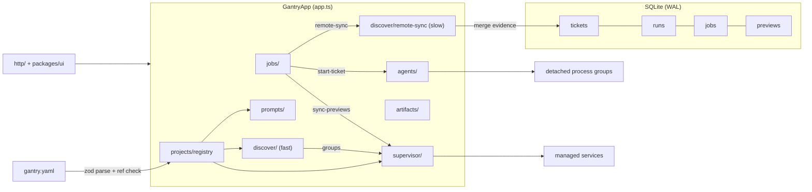

# Architecture

Gantry is an npm-workspaces monorepo with three TypeScript packages and a React dashboard:

| Package | Purpose |
| ------- | ------- |
| `packages/shared` | Zod config schema, `${var}` interpolation, branch/paths/redaction utilities, agent capability model, ticket types |
| `packages/server` | Application core: database, project registry, worktrees, discovery, supervisor, jobs, tickets, prompts, agents, artifacts, HTTP, importer |
| `packages/cli` | The `gantry` binary: `serve`, `add`, `init`, `import-legacy`, `status`, `open` |
| `packages/ui` | React + Vite dashboard (tickets, previews, pull requests) |

Everything persists in a single SQLite database (via `node:sqlite`) inside a private per-user data directory. Project *definitions* live in `gantry.yaml`; the database holds only runtime state (tickets, runs, jobs, previews, ports).

## Big picture



## Application core

`packages/server/src/app.ts` defines `GantryApp`, the owner of every long-lived subsystem: the database, the project registry, the `Supervisor`, the `AgentRegistry`, the `TicketStore`, the `PortAllocator`, the `JobQueue` and the `RemoteSync`. The HTTP layer is a thin consumer of this object; the CLI constructs the same object for `serve` and a lighter, read-only path for `add`.

Four timers run after startup, all `unref`'d:

- fast discovery tick (`discoverIntervalMs`, default 15 s)
- remote sync (`remoteSyncIntervalMs`, default 120 s)
- service health pass (every 2 s)
- adopted-run liveness poll (every 2 s)

Registered workspaces are reloaded from disk on every discovery pass, so editing `gantry.yaml` takes effect without a restart. A workspace that fails to load is logged and skipped; it never takes the whole control plane down.

## Modules

### `packages/shared`

- `config/schema.ts` — the Zod schema for `gantry.yaml` (see [configuration.md](./configuration.md)) plus `parseProjectConfig` (collects *all* problems) and `validateConfigReferences` (unknown repository/service references, missing `start` for `runtime: command`, dependency cycles, `banner.autoLogin` requiring an environment).
- `config/vars.ts` — one `${var}` interpolation engine shared by config values, hooks, health URLs and prompt templates. `$$` escapes a literal `$`; unknown variables raise `VarError` listing the closest available names.
- `paths.ts` — `validateManagedPath`, `safeJoin`, `isInside`: the path-traversal guard used for every path that comes from config, tickets or URLs.
- `branch.ts` — branch slugging and `git check-ref-format`-equivalent validation for branch names derived from untrusted ticket titles; `worktreeFolderFor` maps `codex/fix-x` to `codex--fix-x`.
- `redact.ts` — `redactEnv` (key names + lengths only), `redactRecord`, `scrubSecrets`.
- `agent.ts` — the serializable `AgentCapabilities` model (`resumeMode`, `takeover`, `interruptMode`, `deepLinkScheme`, `streaming`, `notes`).
- `prompt/types.ts`, `ticket.ts`, `ids.ts` — prompt layers, ticket view types, stable `idFor` (content hash) and `newId` (UUID).

### `db/` — SQLite and numbered migrations

`openDatabase` sets `journal_mode = WAL`, `foreign_keys = ON` and `busy_timeout = 5000`, then applies `src/db/migrations/NNN_*.sql` in filename order inside `BEGIN IMMEDIATE` transactions, recording each in `schema_migrations`. `001_init.sql` creates `projects`, `tickets`, `runs`, `jobs`, `previews`, `preview_checkouts`, `preview_services`, `port_allocations`, `artifact_files`, `settings`. Two later migrations add `runs.created_at` and `jobs.worker_id`.

Two partial unique indexes carry most of the correctness:

```sql
CREATE UNIQUE INDEX tickets_active_run ON tickets(active_run_id) WHERE active_run_id IS NOT NULL;
CREATE UNIQUE INDEX jobs_active_dedupe ON jobs(dedupe_key) WHERE state IN ('queued','running') AND dedupe_key IS NOT NULL;
```

### `projects/registry.ts`

`loadProject` resolves the workspace realpath, finds `gantry.yaml` / `gantry.yml` / `.gantry.yaml`, parses and validates it, runs reference validation, and then requires every repository path to resolve *inside* the workspace (`validateManagedPath`) — rewriting relative paths to workspace-relative form. `project.worktreeRoot` must not contain `..`. Registration is idempotent per project id; YAML stays the source of truth.

### `git/` — worktree plumbing

`listWorktrees` parses `git worktree list --porcelain -z` (NUL-delimited, space-safe). `ensureWorktree` is idempotent:

1. Validate the branch with `git check-ref-format --branch`.
2. If a worktree for that branch already exists anywhere (Codex-made, Claude-made, hand-made), reuse it unchanged.
3. If the destination directory exists but is not a registered worktree, fail loudly instead of clobbering it.
4. Otherwise create it, preferring an existing local branch, then a remote branch, then a bounded fetch (default 20 s) of the remote default branch.

A failed or slow fetch never fails ticket creation — local refs remain a valid base. Destructive flags (force, detaching dirty trees) are deliberately not offered; `isDirty` and `hasUnpushedCommits` exist to refuse such operations. `pruneWorktrees` only prunes stale administrative entries.

### `discover/` — fast grouping vs slow sync

`discover.ts` is local-only and cheap enough for every tick: `git worktree list` per `product` repository, grouped by branch. The primary checkout of each repository forms the `__primary__` group; other worktrees group by exact branch name; a group missing a `required` repository falls back to that repository's primary checkout (so a one-sided worktree still gets a working preview); optional repositories join only on exact match and are never substituted with unrelated code.

`remote-sync.ts` is the slow path and is never invoked from the ticket-start path. It refreshes the remote default branch over Git, lists open PRs when the GitHub CLI is authenticated, recomputes merge evidence, retires previews whose changes are fully integrated, and completes the matching tickets. `merge-evidence.ts` verifies *patches* rather than trusting PR numbers: `git patch-id --stable` comparison of the aggregate feature diff against the patches that reached the default branch, `git cherry` for equivalent patches, and a two-hop check for a PR squash-merged into a feature branch that was then squashed into the default. A missing `refs/pull/N/merge` is never evidence of a merge (closed/conflicted PRs lack it too), and a vanished remote branch alone never retires a preview. Proofs are cached per `(head, path, branch)` so a confirmed merge stays confirmed while offline.

### `supervisor/` — desired-state reconciliation

`Supervisor.tick()` reconciles what the database says against what discovery found:

- discovered previews stay stopped; active ones start services in `dependsOn` topological order
- a service whose *signature* changed (command, port, checkout, env-file mtimes/sizes, selected environment) is restarted
- dead services restart with bounded backoff (`retry_after`, 60 s)
- paused/archived/removed/retired previews are stopped and left alone
- a preview whose worktree disappeared is stopped and marked `gone`

Environment assembly (`env.ts`) has a fixed precedence, later layers winning:

1. Gantry's inherited environment
2. repository env files from the primary checkout
3. repository env files from this preview's checkout
4. the selected environment's private env files (workspace-relative)
5. the selected environment's non-secret `env` values
6. per-service `env` values (interpolated with `${port}`, `${repoDir}`, …)
7. Gantry runtime markers (`PORT`, `HOST=127.0.0.1`, `GANTRY_*`)

Managed runtimes (`vite`, `node`, `python`) boot the checkout's own code through the runners in `packages/server/runners/` — the Vite runner injects the local-preview banner (and optional auto-login) without modifying the checkout, the Node runner registers `ts-node` when present and imports the `entry` module's `initServer()`/`app`, the Python runner imports `$GANTRY_ENTRY` from `src/` and serves its `app` on `127.0.0.1:$PORT`.

Readiness: a managed runner writes a ready file, otherwise `healthUrl` is probed, otherwise a service is ready after surviving five seconds. Failing to become ready within `serviceReadinessTimeoutMs` marks the service failed.

### `jobs/` — durable queue

Every long-running operation is a queued, phase-reporting job, so API calls return `202` immediately and progress is visible in the UI. Guarantees:

- `dedupeKey` + partial unique index keep at most one active job per logical operation (double-clicking Start cannot double-spawn an agent; the racing enqueue returns the existing row)
- claims record a `worker_id` and `lease_until`; on restart, `recoverLeases` re-queues jobs whose lease belongs to a dead worker (bounded attempts, so a crash loop cannot spin forever)
- handlers receive `progress(phase, percent, detail)`, a log sink and an abort signal, and must be idempotent

Built-in kinds: `start-ticket`, `sync-previews`, `remote-sync`.

### `jobs/handlers/start-ticket.ts`

Phases: `worktrees` (10-50%) -> `agent` (60-90%) -> `preview` (95%). It creates the run row, claims `tickets.active_run_id` atomically (losing the race deletes the row and fails fatally), moves `backlog` tickets to `in_progress`, ensures worktrees per worktree-enabled product repository, creates the ticket's artifact directory, allocates ports up front so the prompt can name real preview URLs, renders the prompt (or uses an explicit override), starts the agent with worktrees + artifact dir as additional directories, and finally enqueues preview prep so the agent never waits for services.

### `tickets/` — the board

A local work queue per project: `backlog` / `in_progress` / `done`, explicit ordering, branch derived from the title and validated before any worktree is created. `active_run_id` is the atomic start lock — a partial UNIQUE index means even two racing jobs cannot both attach a run. The branch cannot change once work has started. `reorder` requires the submitted order to be complete and current, and applies it in one `BEGIN IMMEDIATE` transaction. `completeMergedBranches` moves tickets to Done when their branches are proven merged.

### `prompts/`

`engine.ts` composes a prompt from named layers: base template (builtin or project, following `extends` chains with cycle detection) -> repository instruction files found on disk (`AGENTS.md`, `CLAUDE.md`, plus workspace-level files) -> agent-specific notes -> per-ticket additions. Templates use the same `${var}` engine as config, so an unknown variable fails before anything starts. Two builtin templates ship: `builtin:default` and `builtin:paper-setter-legacy`, a variable-generalized port of the legacy `ticketPrompt` (additive `TEST_` records only, `manual-test-needed.md` when automation must stop, evidence saved as `trace.zip`, `video.webm`, `final.png`, `summary.md`, evidence never committed or uploaded).

### `agents/`

`types.ts` defines the `AgentAdapter` contract (`resolveBinary`, `capabilities`, `buildStart`, `buildResume`, `deepLink`, `parseSessionLine`). `registry.ts` is the run engine: runs are detached process-group leaders whose `(pid, pgid, pid_claim)` triple is persisted; session ids are parsed from streamed output and persisted, which is what makes resume and deep links work. `takeover()` moves a run through explicit states — `interrupting` while signaling, `ready` once the session is free, `failed` when ownership could not be verified. Startup recovery re-verifies recorded runs and adopts live processes; a liveness poll finalizes adopted runs.

### `artifacts/`

Ticket evidence may contain authenticated page data, so only an allowlist of five filenames is ever served: `manual-test-needed.md`, `video.webm`, `trace.zip`, `final.png`, `summary.md`. Paths are built from a UUID-checked ticket id plus the allowlist, never from URL segments; directories are created `0700`; text renders inline, zips download, nothing executes.

### `http/`

Fastify with one `onRequest` gate: host allowlist for everything, same-origin JSON for every mutation. Strict CSP headers on JSON and logs, sandboxed headers on artifacts. Routes cover status, projects, prompt preview, tickets (create/update/reorder/prompt/start/handoff/resume/delete), preview actions (`pause`, `resume`, `restart`, `retry-dependencies`, `archive`, `restore`, `environment`), log tails and artifacts. `status.ts` assembles the single snapshot the dashboard renders and ends with `env: redactEnv({})` — an explicit statement that no environment values are ever included.

### `importer/legacy.ts`

Reads the legacy preview manager's state directory and produces a complete `gantry.yaml`, ticket rows, and preview preferences. See [migrating-from-legacy.md](./migrating-from-legacy.md).

## Reliability invariants

1. **Atomic start lock.** `tickets.active_run_id` is protected by a partial UNIQUE index. Exactly one active run per ticket, across racing jobs and restarts.
2. **Durable jobs.** Work happens in the queue, not in request handlers: dedupe keys prevent duplicates, leases recover from crashes, attempts are bounded, handlers are idempotent.
3. **Fast vs slow discovery separation.** Ticket starts use local `git worktree list` only. Fetches, `ls-remote` and `gh` calls live in the remote-sync loop and are additionally bounded by timeouts, so a slow network cannot delay an agent.
4. **Ownership verification before any signal.** No pid is ever trusted from the database alone: `ownsProcess` re-checks pgid and the command claim via `ps` immediately before `interruptProcessGroup` sends SIGTERM (then SIGKILL after the grace period). Unverifiable processes are reported and left alone.
5. **Archive by default; confirm cleanup.** Removing a workspace keeps its data (`projects.removed_at`) unless the user explicitly chooses to delete it, and never touches its folder, repositories or worktrees. Previews are archived (releases their ports, keeps everything else). Gantry never discards uncommitted changes or checks a different branch into an existing worktree. Removing a *ticket* removes the card from the board; the branch and worktree stay on disk. A separate confirmed cleanup action can remove clean, merged ticket worktrees while retaining branches and history (see below).

### Confirmed worktree cleanup

`GET /api/tickets/:ticketId/worktree-cleanup` assesses registered checkouts on demand and returns `{ ticketId, ticketIds, checkouts, blockers }`. `ticketIds` is the sorted set of all tickets in the project sharing the branch. Each checkout includes its repository ID, path, HEAD, eligibility and reason. `POST` to the same endpoint requires `{ confirm: true, ticketIds, checkouts: [{ repositoryId, path, head }] }` and returns per-checkout `removed`, `blocked` or `failed` results plus a fresh assessment. The runtime rejects a changed ticket scope, and caller-supplied paths and HEADs are matched to live discovery before use.

`tickets/cleanup.ts` checks Done status across tickets sharing a branch, active runs/jobs/services, managed-root containment, protected primary/default checkouts, worktree locks, tracked/untracked changes, branch and HEAD identity, and merge evidence against the locally available remote-default ref. Squash/rebase patch verification requires an existing proof matching the current checkout; nested squash verification also uses cached parent-PR refs and locally available intermediate commits to revalidate both patch relationships. Missing parent data fails closed until the workspace's merge status is refreshed. A stored retirement flag alone never authorizes deletion. Assessment and cleanup perform no network requests. Removal uses `git worktree remove` without force and keeps branches, tickets, evidence and conversation associations. Successfully removed checkout rows are cleared independently, preserving partial progress.

The runtime excludes concurrent workspace mutations and preparation while holding the supervisor's project discovery lock. The desktop bridge resolves the shared-branch ticket IDs from the runtime and acquires every ticket's workflow and conversation locks in deterministic order. It refreshes that scope under the locks and rechecks running/queued workflows, live workers, running attempts/steps, and pending/queued embedded agents for every peer. Paused or waiting workflow history with no active work is eligible. Checkout reservations also exclude running/queued local-review agents and block new review turns during removal. Interactive agents outside Gantry must be closed by the user before confirmation. Discovery, merge completion, preview archival and ticket deletion never invoke cleanup automatically.

## Where things live

```text
~/Library/Application Support/gantry      macOS
$XDG_DATA_HOME/gantry | ~/.local/share    Linux
%APPDATA%/gantry                          Windows
```

Override with `GANTRY_DATA_DIR`. Inside: `gantry.db` (+ WAL/SHM), `logs/`, `runs/`, `artifacts/`, `tmp/`, `ready/`, `installs/`. Gantry never writes inside a workspace except for the worktree root it is configured to manage.

### Desktop ticket graph

The Tickets area offers Board and Graph views over the same status snapshot and
ticket cards. The graph connects tickets to their current stage (not to inferred
dependencies). Search and the in-progress filter only affect graph visibility.
Ticket creation, details, editing, stage changes, conversations, reviews and
previews use the existing handlers and dialogs.

While the graph is visible, the desktop refreshes status every two seconds and
on focus/visibility restoration. The existing request guard serializes refreshes;
hidden tabs stop polling. Failed requests retain the last snapshot and display
the connection warning. The desktop status bridge adds the saved conversation
association without creating or opening a chat. External provider activity is
not inferred: workflow updates and managed run state remain the sources of
progress. A linked conversation alone does not mean an agent is running.

### Automatic workspace workflows

Workspace graph is a page with a draggable canvas. Add nodes, drag an output
connector onto another node, and click the resulting edge to describe its
condition. Node dialogs contain name, instructions, provider, model, and reasoning
effort. The start node is explicit. Empty boards are valid drafts; all nodes must
be reachable before automatic execution can be enabled. Positions and edge labels
are saved in workspace YAML and copied into new tickets. Unsaved browser drafts
survive navigation in the same tab. Saving an older workspace graph converts its
dependencies and correction targets into named connections; existing ticket
snapshots and running executions retain their original behavior.

For graphs with `edges`, Gantry maintains a separate coordinator conversation
using the ticket's default provider. After each stage handover, the coordinator
reads the graph, natural-language edge conditions, stage states, and recent
results. It chooses a configured edge and explains why it applies. It can return
to earlier nodes or finish other required branches before a join. Branch and join
conditions are interpreted by the model; they are not a formal boolean rule
language. These routing calls consume provider usage. The coordinator uses a
read-only Codex session, a Claude session without tools, or an API call without
tools. Each working node has its own session and model settings.

The executor validates decisions before dispatch: the edge must exist, its source
must have completed (or be the current correction request), and the target must
stay within its visit limit. Corrections reset the target and reachable downstream
states, preserving prior attempts. Completion requires a successful terminal node
with no outgoing edges. Ambiguous conditions, invalid responses, failures, and
exhausted visit limits pause the ticket with an in-app attention notice. Limits
default to three visits per node; a user can explicitly retry after inspection.
Routing decisions and the coordinator's session ID are persisted with the run.

The scheduler runs up to ten tickets concurrently and one working node per ticket.
A kernel-owned local socket elects one executor per data directory. Graphs without
`edges` retain the original dependency scheduler and bounded `retryTarget` logic.
Legacy `workspaceExclusive`, `freshSession`, and human-node settings remain
supported in saved runs but are not presented in the new editor. A merge is still
an action defined by the node's instructions, not an independently enforced merge
gate. The coordinator must not substitute model judgment for required validation.

Enable **Run automatically** on the workspace graph, or use **Start workflow** on
a ticket. Execution authorizes the stage agents to run local tools without routine
approval prompts. Existing external chats require a handoff first. Codex and Claude
retain native conversation IDs. OpenAI-compatible endpoints receive repository
and shell tools; their output is available in Gantry. Model selectors read Codex's
local model catalog and aliases documented by the installed Claude CLI. Provider
defaults, saved model IDs, and custom IDs remain available if discovery fails.
Unsupported model/effort settings fail visibly rather than silently substituting.

Run state and bounded output are atomically persisted under
`~/.pr-lens/workflow-runs` (or `PR_LENS_HOME`). Keep the desktop server running;
the browser tab can be closed. Interrupted working stages pause after restart to
avoid replaying unknown side effects. A persisted routing checkpoint can retry
the coordinator without repeating completed implementation work. Pause aborts
the active provider process; it does not undo completed edits or external actions.
On macOS, **Open stage chat** opens a Codex deep link without pausing or launching
another agent. For chats opened through Gantry, the executor reads durable Codex
turn events before handover, waits for an active follow-up, and uses the latest
completed turn's structured result after two stable observations. Unknown,
interrupted, or unstructured results stop execution for attention. Changes to an
earlier opened chat are checked at stage boundaries and require retrying that
stage. This is boundary checking, not an atomic lock on Codex's composer: a message
sent after a handover cannot retroactively prevent work already dispatched.
Claude and non-native terminal resumes still require pausing; API providers use
Gantry's stage history. Stop terminal manual work before resuming automation. The desktop bridge
exposes the execution snapshot; legacy runtime CLI progress is separate and must
not drive automated tickets.

Tests use disposable repositories and fake providers. They cover canvas movement,
connectors, saved layout, models, coordinator decisions, correction loops, bounded
visits, native-session reuse, cancellation, recovery, and legacy graph execution.
