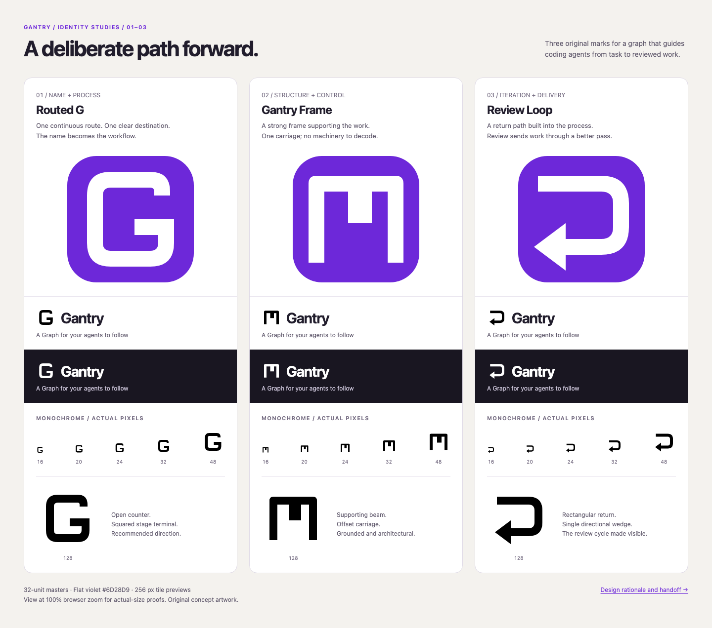

# Gantry logo samples

Three original vector concepts developed from the [icon research](../icon-research.md).
Selection stage: **Pick best logo**. **Routed G is selected for implementation.**
The board below preserves the three original candidates for comparison.



Open [the comparison board](index.html) locally in a browser at **100% zoom** for
actual-size proofs. It works directly from disk, with no server, network requests,
JavaScript, or additional dependencies. GitHub displays the PNG above; it does not
render the HTML board as a web page.

## The three directions

### 01 — Routed G · selected

[Editable SVG master](routed-g.svg)

A continuous, squared-off route forms the initial **G**. Its inward terminal is a
destination within the process. This connects the product name with guided agent
work without drawing nodes, branches, agents, and checks at once. Rounded outer
turns soften the substantial band; flat terminals keep the construction precise.

The strongest candidate for a standalone identity: the initial gives viewers a
name cue even when the wordmark is absent. The open counter and six-unit mouth
leave room at small sizes. Its main tradeoff is the crowded field of G monograms;
the shape should be compared with adjacent products before final adoption.

### 02 — Gantry Frame

[Editable SVG master](gantry-frame.svg)

Two supports and one beam carry a slightly offset carriage. Gantry provides the
structure within which agents do their work. A single solid silhouette replaces
crane cables, hooks, feet, and other construction details. The carriage's unequal
side spaces give a restrained asymmetry rather than a generic symmetrical arch.

This is the most literal connection to the name and the simplest construction.
Its main tradeoff is an industrial or architectural reading; the product's graph
behavior is less apparent, and some viewers may see a stylized M or pi.

### 03 — Review Loop

[Editable SVG master](review-loop.svg)

A broad rectangular path returns through a single left-facing wedge: feedback
routes work back for another pass. The open left edge and noncircular outline
avoid a two-arrow synchronization symbol. Compared with the research sketch, the
terminal is explicitly directional to distinguish this mark from the Routed G.

This communicates the review behavior most directly. Its main tradeoff is that
it can also read as undo or return, making it less distinctive as an app identity.

## Shared construction rules

- **One idea, one filled path per mark.** Original geometry drawn for this ticket;
  no copied brand artwork, icon-library paths, embedded fonts, or linked assets.
  Artwork follows the repository's MIT license.
- **32 × 32 viewBox.** Primary bands are four units wide, equivalent to two pixels
  at a 16 px canvas. Rounded turns are part of the outline, not effects.
- **Transparent, unmasked masters.** Black by default through `currentColor`;
  inline SVG can inherit a chosen color. An SVG loaded through `` does not
  inherit the host page's text color. The board uses inversion for white previews.
- **One palette for a fair comparison.** White marks on violet `#6D28D9`, black on
  white, and white on ink `#191621`. No gradients, shadows, or status-color nodes.
- **Breathing room.** Marks occupy 69–75% of the tile width. Keep at least four
  master units of clear space outside the visible silhouette in standalone use.
  The tile backgrounds are presentation containers, separate from the masters.
- **Wordmark context.** The board pairs each symbol with the system-font name and
  the real README headline. These are typography studies rather than outlined,
  finalized wordmark assets. Text is kept outside the launcher icon.
- **Accessible presentation.** SVGs have titles/descriptions, standalone images
  have descriptive alternatives, and symbols beside “Gantry” are decorative.

## Selection decision and handoff

Selected **Routed G** on 2026-10-26. Use [routed-g.svg](routed-g.svg) as the
canonical geometry for production integration. It balances the immediate **G**
name cue, a continuous process route, and a compact silhouette better than the
other two candidates.

### Comparative evaluation

The following scores apply the [research rubric](../icon-research.md#shortlist-and-comparison-rubric)
to the existing comparison image and SVG construction. Scores are qualitative
design judgments on a 1–5 scale, not measured recognition or user preference.
Small-size judgments also draw on the sample stage's recorded raster checks below;
no new browser or native-platform rendering was performed in this selection stage.

| Criterion                   | Weight  | Routed G | Gantry Frame | Review Loop |
| --------------------------- | ------- | -------- | ------------ | ----------- |
| Distinctive silhouette      | 30      | 4        | 3            | 2           |
| Actual-size legibility      | 25      | 4        | 4            | 4           |
| Fit to name and process     | 20      | 5        | 3            | 4           |
| Consistency across contexts | 15      | 5        | 5            | 5           |
| Production simplicity       | 10      | 5        | 5            | 5           |
| **Weighted total / 100**    | **100** | **88**   | **75**       | **73**      |

Totals use `sum(weight × score / 5)`.

- **Routed G wins on identity and fit.** Its open counter, squared inward terminal,
  and rounded rectangular route remain recognizable in monochrome and in both
  documentation themes. The 16 px proof retains the opening, although the route
  metaphor is clearer at larger sizes. A G monogram is a crowded category, so its
  distinctiveness score is deliberately below perfect.
- **Gantry Frame is the runner-up.** The beam and carriage give a strong structural
  silhouette, but the tiny proof loses much of the offset-carriage character.
  It can read as an M or pi, and suggests construction more readily than agent
  workflows. Its simple production geometry does not offset that weaker fit.
- **Review Loop communicates behavior rather than identity.** The return wedge
  makes iteration clear, but it strongly resembles an undo/return control. That
  familiar action-symbol reading makes it the weakest standalone app identifier.

This decision applies the researched design practices: one dominant idea,
monochrome-first evaluation, visible negative space, restrained color, and
comparison in real name/headline contexts. Those principles favor Routed G even
without the violet treatment. No blind reviewer study or new comparison against
third-party app icons was conducted; this is a selection among these three samples.

### Selected treatment

- Preserve the original single-path geometry and 32 × 32 viewBox.
- Use a **white Routed G on violet `#6D28D9`** for the primary app-icon treatment.
  Keep the container separate from the unmasked master for platform exports.
- Use black on light surfaces and white on dark surfaces for monochrome branding.
  Provide explicit theme-safe README assets; an SVG in an `` cannot inherit
  the surrounding text color through `currentColor`.
- Keep the full **Gantry** name outside launcher tiles. Preserve the existing
  clear-space guidance and inspect optical size after platform export.
- Retain the original-artwork provenance and repository MIT license described
  above. The selected geometry does not use Lucide or the researched company marks.

The board includes 16, 20, 24, 32, 48, and 128 px monochrome glyphs plus 256 px
launcher tiles for every candidate, with light and dark documentation lockups.
The source SVGs remain editable independently of the presentation.

Use the selected master to produce the README assets and Electron,
favicon, and platform exports described in the research handoff. Platform-specific
masking, optical sizing, and packaged Dock/taskbar checks belong to that integration.

### Sample-stage verification

Rendered and visually inspected `comparison.png` in Chromium at device scale 1.
The Routed G mouth remains open at 16 px; Gantry Frame retains two separate
channels beside its carriage; Review Loop retains its return wedge and open left
edge. At 16 px the frame's subtle asymmetry is less apparent, and the loop reads
more as a familiar return arrow. The same silhouettes carry through the large
tiles and both wordmark backgrounds.

Against the research rubric, Routed G offers the best name cue, Frame the simplest
structural silhouette, and Loop the clearest iteration cue. All three use the
same single-path production model and survive the displayed size range. Fit and
distinctiveness remain designer assessments: no blind reviewer study or
side-by-side comparison with installed third-party app icons was conducted, so
this handoff does not assign a measured recognition score.

Checks completed:

- Chromium loaded all **27 image instances** at **1440, 390, and 320 px** viewport
  widths, with exact declared proof dimensions and no horizontal page overflow.
- All three standalone SVGs parsed without XML errors, have an accessible title,
  contain exactly one path, and keep their geometry inside the 32-unit viewBox.
- No browser page errors, failed requests, or external requests occurred.
- Prettier checks passed for the HTML, Markdown, and SVGs (using its HTML parser
  for SVG); new-file whitespace checks passed.
- Application tests and native packaged-platform checks were not run for this
  static artwork stage.

To regenerate the PNG from the repository root with the existing Playwright
installation and Chromium browser:

```sh
npx --no-install playwright screenshot \
  --browser chromium \
  --viewport-size="1440,1200" \
  --full-page \
  "file://$(pwd)/docs/logo-samples/index.html" \
  docs/logo-samples/comparison.png
```

The SVG geometry is independent of system fonts; the board's wordmark text can
vary slightly by operating system. `comparison.png` records the reviewed render.
